# Dispatch - Flutter Trading Companion for Crypto Perps

Open and close leveraged BTC, ETH and SOL positions from your phone with almost no friction. Sign in with Google or Apple, build a trade right away, and connect a wallet only when you tap **Post trade**. Two signatures grant a 30-day, trade-only session key, so after that there is no wallet pop-up per trade. The app never holds funds and cannot deposit, withdraw or transfer.

Flutter + Riverpod app, plus a Node signer service (`backend/`) for per-user key custody, EIP-712 intent signing, a hash-chained audit log and the weekly builder-fee payout job.

## Demo

| iOS | Android |
|---|---|
|  |  |

Same codebase running on both platforms.

## Screenshots

| Sign in | Trade, no wallet yet | Connect on Post |
|---|---|---|
| 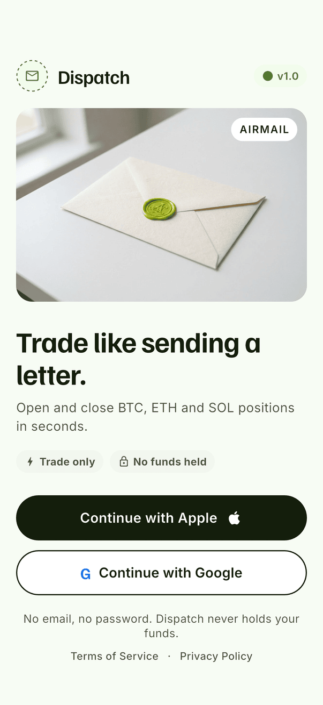 | 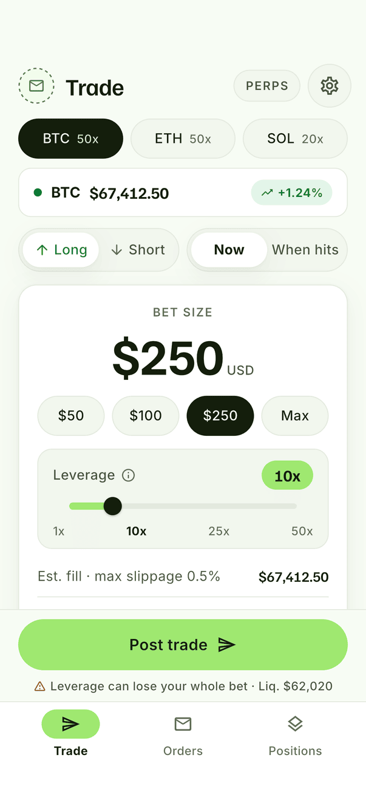 | 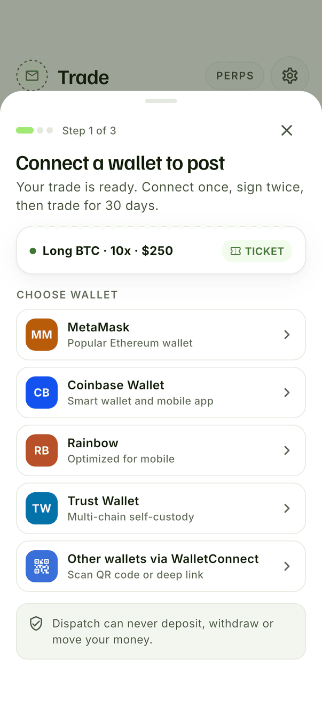 |
| **Prove ownership** | **30-day trade-only key** | **Posted** |
| 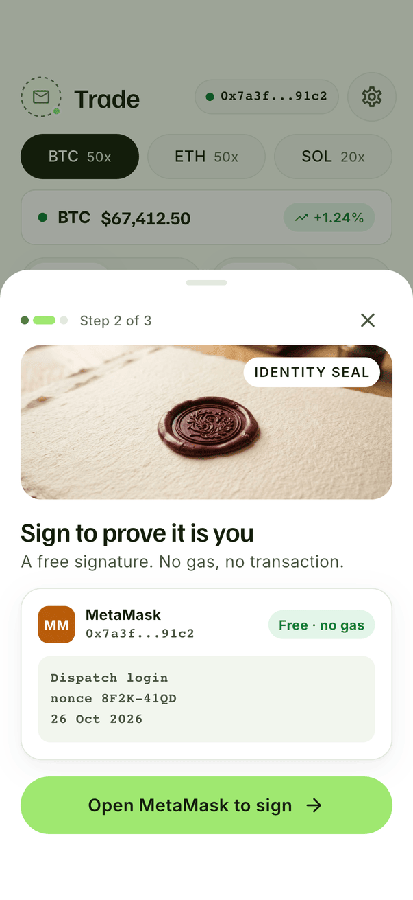 | 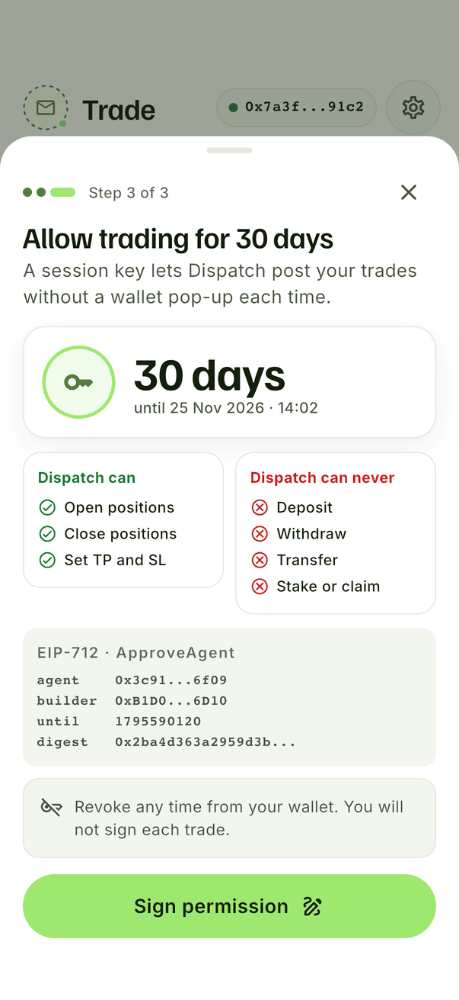 | 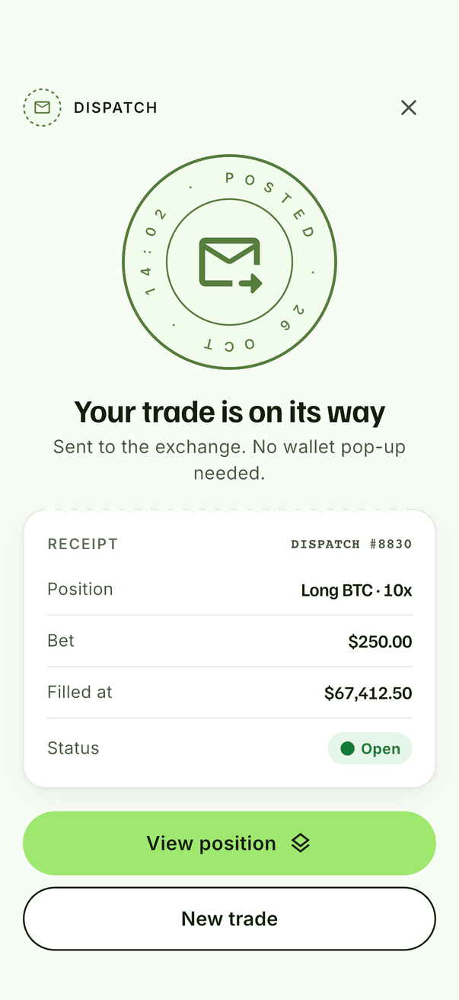 |
| **Positions, live P&L** | **Close without a pop-up** | **Trigger order + TP/SL + price scale** |
| 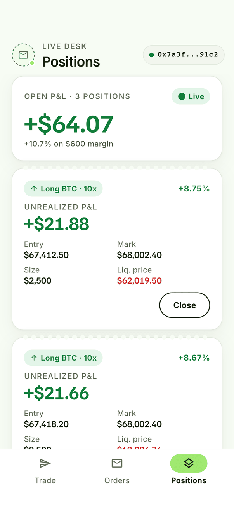 | 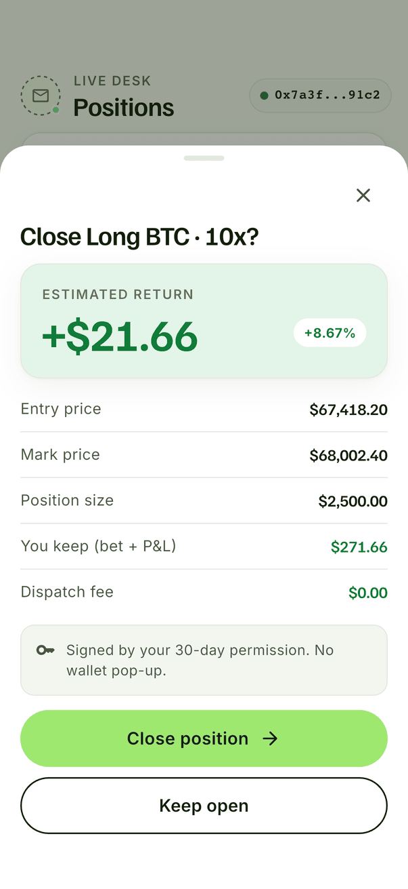 | 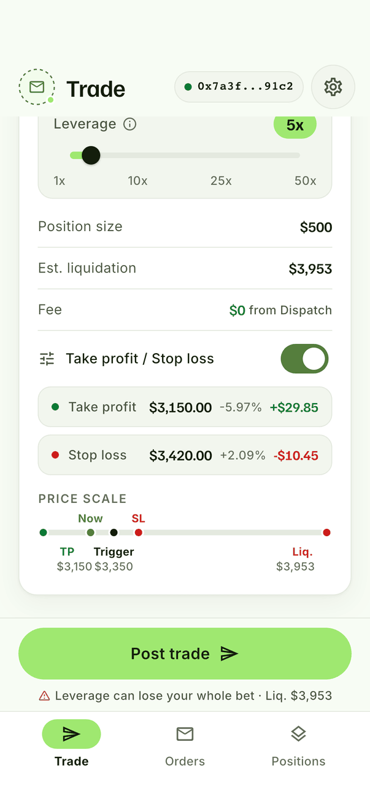 |
| **TP/SL editor (price or %)** | **Orders, waiting** | **Orders, completed** |
| 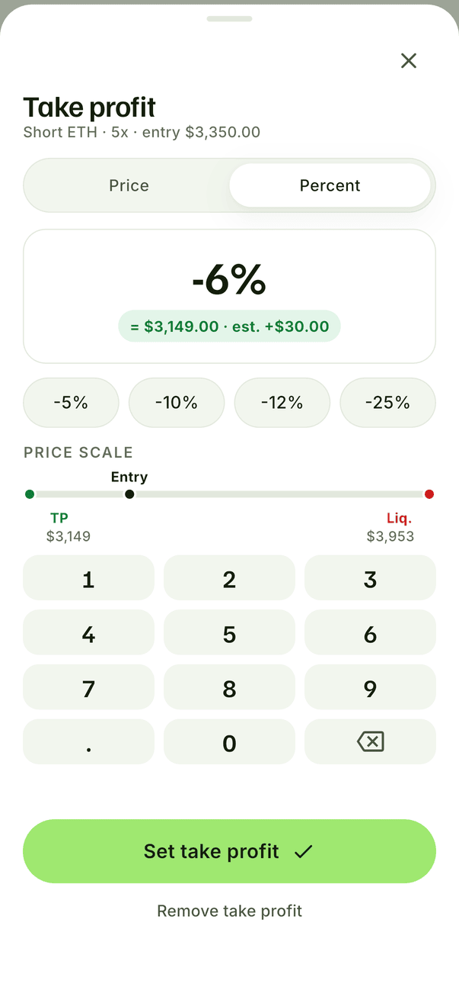 | 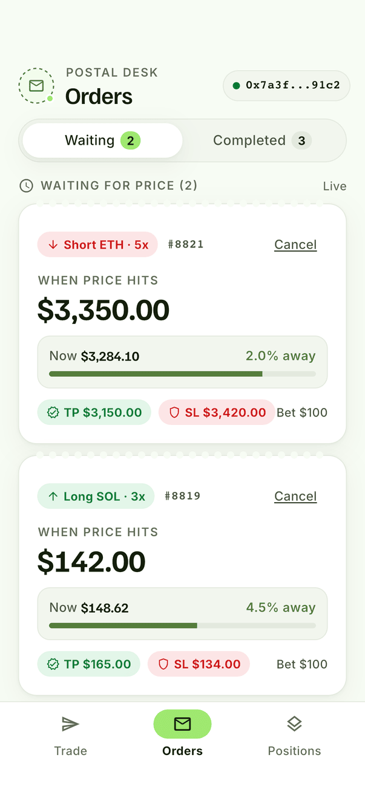 | 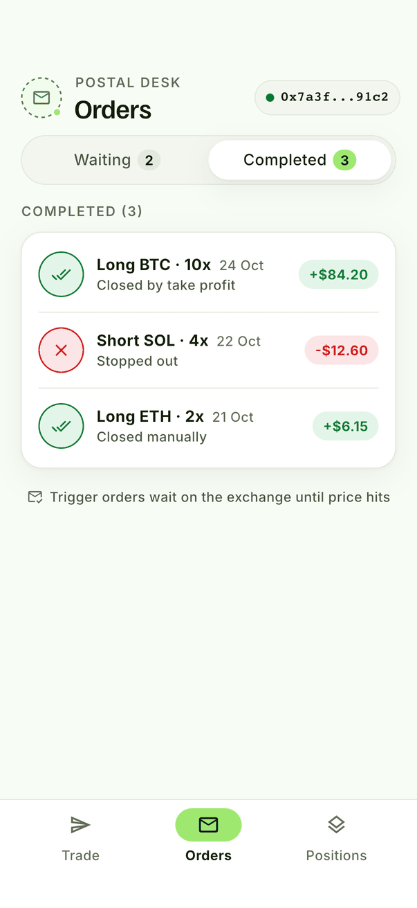 |
| **Settings** | **Weekly USDC rewards** | **5 days left warning** |
| 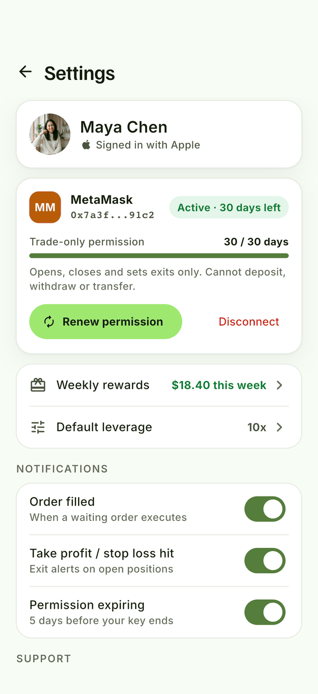 | 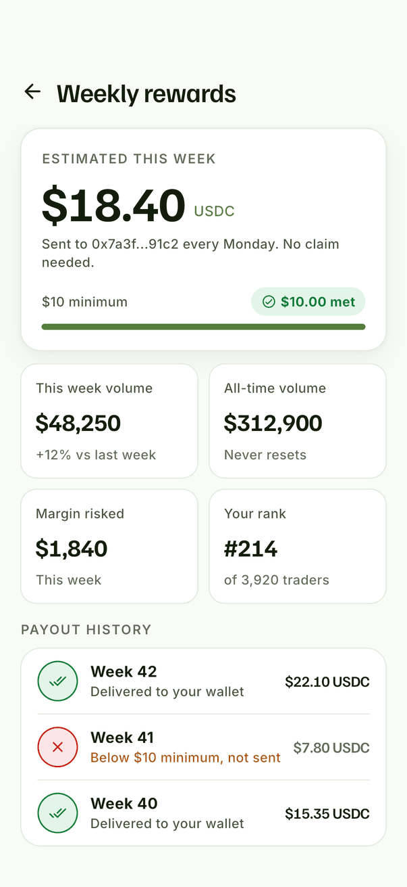 | 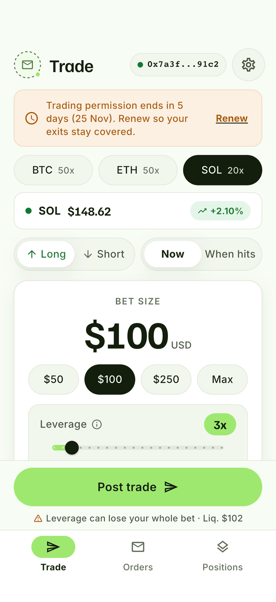 |
| **Blocking re-sign** | **Empty orders** | **Empty positions** |
| 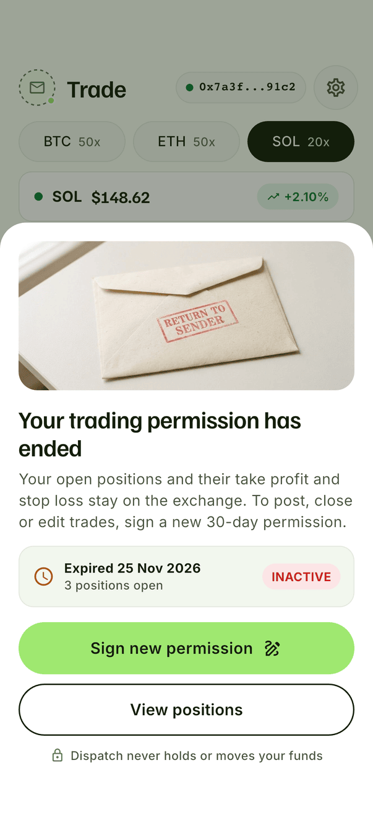 | 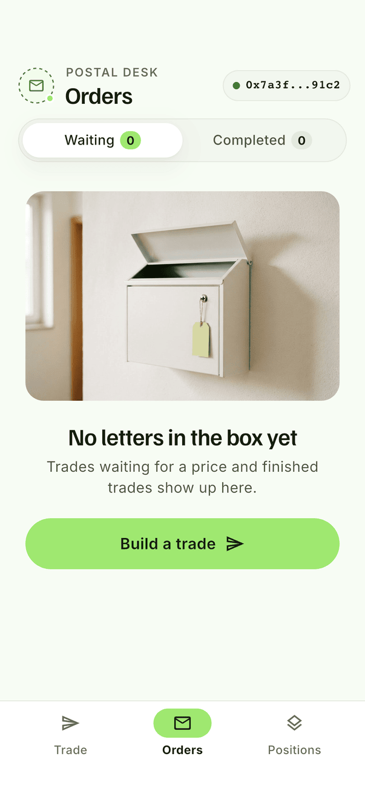 | 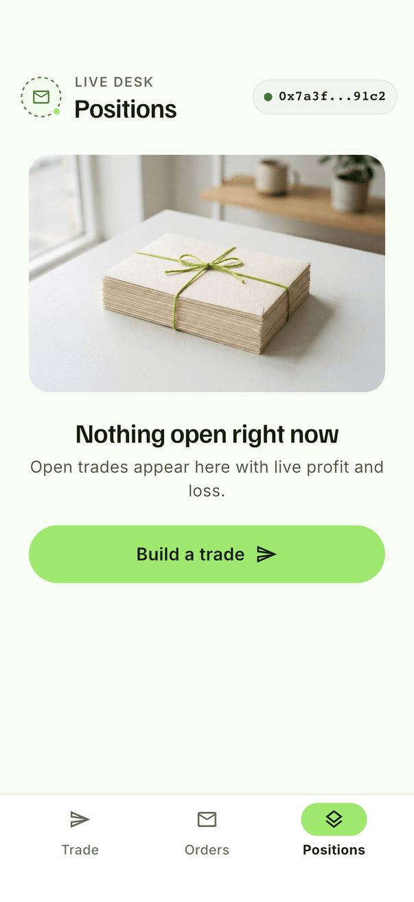 |

## Flow

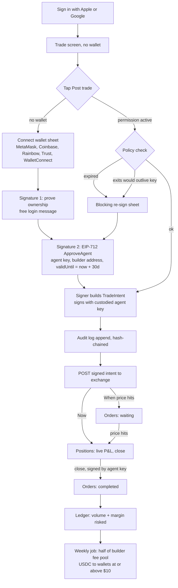

## What it shows

- **Wallet only at Post.** Sign-in is Google or Apple only (no email, password or phone). The full trade screen works before any wallet exists. Tapping Post opens the wallet flow as bottom sheets: connect, prove ownership, grant permission, then the trade goes out.
- **30-day trade-only session key.** The `ApproveAgent` EIP-712 message binds the server-held agent address, the approved builder fee address and a hard `validUntil`. The agent key can only sign `TradeIntent` (open / close / reduce-only). There is no field it could use to move funds.
- **Expiry handling.** A warning banner at 5 days left, and a non-dismissable re-sign sheet when the key has expired or when a new trade's take profit / stop loss could still be resting after expiry. Positions and their exits stay on the exchange; only posting, closing and editing need the new key.
- **Trade builder.** BTC / ETH / SOL with live reference prices, Long or Short, Now or When price hits, bet size chips, leverage slider with per-market max, TP/SL with a price-or-percent keypad editor, and a visual price scale (liquidation, stop loss, entry or trigger, now, take profit).
- **Orders and positions.** Waiting trigger orders with distance to price and cancel, completed results with postmark stamps, open positions with live P&L, liquidation price and close.
- **Weekly rewards.** Estimated USDC share, volume and margin stats, rank, and payout history including a week below the $10 minimum that was not sent.

## Architecture

```
lib/
  models/            TradeDraft, Order, Position, SessionPermission, Wallet
  services/
    eip712.dart      typed-data encoder + keccak256 digest (ApproveAgent, TradeIntent)
    permission_policy.dart  30-day lifetime, 5-day warning, exits-cross-expiry block
    price_feed.dart  reference price stream (seeded random walk in the POC)
    trade_api.dart   backend client: builds intents, hash-chained audit trail
    rewards.dart     weekly share, $10 minimum, no carry-over
  state/             Riverpod providers + trade_flow (post, submit, close)
  screens/           login, trade, TP/SL editor, wallet sheets, posted, orders, positions, settings, rewards
  widgets/           postmark stamp, ticket card with perforated edge, segmented, pills, tab bar
backend/
  src/keystore.js    one agent key per user, AES-256-GCM envelope encryption, user-bound AAD
  src/signer.js      register (verify main-wallet EIP-712 sig), policy check, sign TradeIntent
  src/policy.js      allowlist: open / close only, leverage and bet bounds, expiry rules
  src/audit.js       append-only, hash-chained signing log with verify()
  src/ledger.js      cumulative + weekly volume, ranking, weekly payout job
  src/server.js      JSON API the app calls
design/              design system, per-screen HTML references and logo
```

**Key custody.** Each user's agent key is encrypted with its own data key, and the data key is wrapped by a master key held in the cloud KMS (`MASTER_KEY_HEX` locally). The ciphertext is bound to the user's address as AAD, so a copied row will not decrypt for another user. Keys are decrypted only in memory for the length of one signature. A leaked agent key can at most open or close trades on that one account until its `validUntil` or a revoke from the main wallet. It cannot withdraw, transfer, stake or claim.

**Tests.** `flutter test` covers the permission policy, rewards math and the EIP-712 encoder against the spec's `Person` type-hash vector. `cd backend && npm test` covers registration with a forged signature, agent-key signatures verifying on the domain, the action allowlist, expiry and exits-cross-expiry, encryption at rest and user binding, audit tamper detection, and the payout job.

## Run

```sh
flutter pub get
flutter run                       # iOS simulator or Android emulator

cd backend && npm install && npm test
MASTER_KEY_HEX=$(openssl rand -hex 32) npm start
```

Prices, wallet signatures and the exchange POST are simulated so the app runs on a simulator with no wallet app installed.
